# Fluxogramas — Immersive Engineering 1.7.10 (backport 1.21.1)

Doze diagramas Mermaid, renderizados direto pelo GitHub. Cada um também existe como arquivo `.mmd` em [`diagrams/`](diagrams/) para editar ou exportar (`mmdc -i arquivo.mmd -o arquivo.svg`). Todos foram validados com o Mermaid CLI antes da publicação.

**Legenda de cores nos diagramas de estado:** verde = aprovado/PASS; vermelho = rejeitado/bloqueado; laranja forte = **versão mais recente (R3) ou ponto de retomada**; azul = estático PASS com runtime pendente; cinza = histórico/superado.

Leia junto: [CRONOLOGIA.md](CRONOLOGIA.md) (datas e commits) e [ESTADO-ATUAL-E-RETOMADA.md](ESTADO-ATUAL-E-RETOMADA.md) (o que fazer agora).

---

## 1. Linhagem Git e linhas divergentes

O diagrama mais importante para quem chega: mostra que o R3 (laranja) e a linha Alloy Kiln/Mixer/rede **saem do mesmo ponto (R2) e não se encontram**.

```mermaid
flowchart LR
  classDef ok fill:#d4edda,stroke:#2e7d32,color:#111
  classDef rej fill:#f8d7da,stroke:#c62828,color:#111
  classDef latest fill:#fff3cd,stroke:#ef6c00,stroke-width:3px,color:#111
  classDef pend fill:#e8eaf6,stroke:#3949ab,color:#111
  classDef up fill:#eceff1,stroke:#607d8b,color:#111

  subgraph ANC["Ancestralidade upstream"]
    direction TB
    U0["BluSunrize 1.7.10<br/>c45a3a2 · 2016-05-09<br/>Build and Release v0.7.7"]:::up
    U1["chaos234<br/>c38fd6b → 3cf2a38<br/>era 0.7.8"]:::up
    U2["Bogdan-G 1.7.10<br/>798ce21a · 2017-04-28<br/>XSTR · split de energia"]:::up
    U0 --> U1 --> U2
  end

  B0["0c803472 · 09/09<br/>Baseline Forbidden 0.7.9 em RFG<br/>tag 0.7.9-forbidden-baseline"]:::ok
  U2 --> B0

  subgraph CL["Garden Cloche"]
    direction TB
    C1["415ad44c<br/>tag garden-cloche-test-1<br/>substituída"]:::up
    C2["6 commits de correção<br/>UV · MFR · Magical Crops · AgriCraft"]:::up
    C3["ad5e6201 · 09/09 16:47<br/>tag garden-cloche-test-2<br/>APROVADA funcional"]:::ok
    C1 --> C2 --> C3
  end
  B0 --> C1

  MP["ac69028c · 16/09<br/>tag garden-cloche-multiplayer-test-1<br/>estático PASS · runtime MP pendente"]:::pend
  C3 --> MP

  subgraph AW["Auto Workbench · linha R3"]
    direction TB
    A0["9 commits · a36bb241 … f7d638cb<br/>A0–A4 · 09–10/09"]:::up
    A1["e2ee4453<br/>tag auto-workbench-test-1<br/>REJEITADO · OBJ"]:::rej
    A2["97cea596<br/>tag auto-workbench-test-1-r2<br/>REJEITADO · A5.5"]:::rej
    A3["44bbc72d → a4259bf1 → 53cfd2bf → e0e0aa4e<br/>docs A5.2/A5.3 · regressão · coletor A6"]:::up
    A4["5d467a61 · 17/09 01:21<br/>tag auto-workbench-test-1-r3<br/>MAIS RECENTE · A6 pendente"]:::latest
    A5["ac41e5e7 · 17/09 01:53<br/>HEAD feature/auto-workbench<br/>docs A5.6 + protocolo A6"]:::latest
    A0 --> A1 --> A2 --> A3 --> A4 --> A5
  end
  C3 --> A0

  HM["a55d6fa7 · 16/09<br/>hardening/auto-r2-cloche-mp<br/>MP da Cloche sobre o R2"]:::pend
  A2 --> HM

  subgraph CH["Plano mestre 1.21.1 · linha Alloy/Mixer/rede"]
    direction TB
    P1["94df992b → e0cd905b → 51ce9cc0<br/>charter · áudio · render/rede · 11/09"]:::up
    N1["e7c7e37a → a1b811a6<br/>hardening/network-gate<br/>C2S enfileirado"]:::pend
    N2["c5453e22<br/>hardening/network-gate-chief<br/>verificação estática"]:::pend
    R1["7ada56c1 → 431f3615<br/>gate de registry · Alloy A0–A2"]:::up
    K1["5784567a → 174a5228 → a1376474<br/>tag alloy-kiln-test-1<br/>K4 PASS"]:::ok
    K2["ccaad104<br/>HEAD feature/alloy-kiln"]:::up
    X1["c2ddc2bb → f7a4abd4 → b1fab23f<br/>Mixer A0–A2 + M1 PASS"]:::ok
    X2["7b8863d0 · 12/09 10:04<br/>HEAD feature/mixer<br/>fluido Concrete · sem gate M2"]:::pend
    D1["d7bf99e5<br/>HEAD chief/ie-1.21.1-masterplan"]:::up
    P1 --> N1 --> N2
    P1 --> R1 --> K1 --> K2
    K1 --> X1 --> X2
    R1 --> D1
  end
  A2 --> P1
```

## 2. Cronologia visual

### 2a. Ancestralidade do código

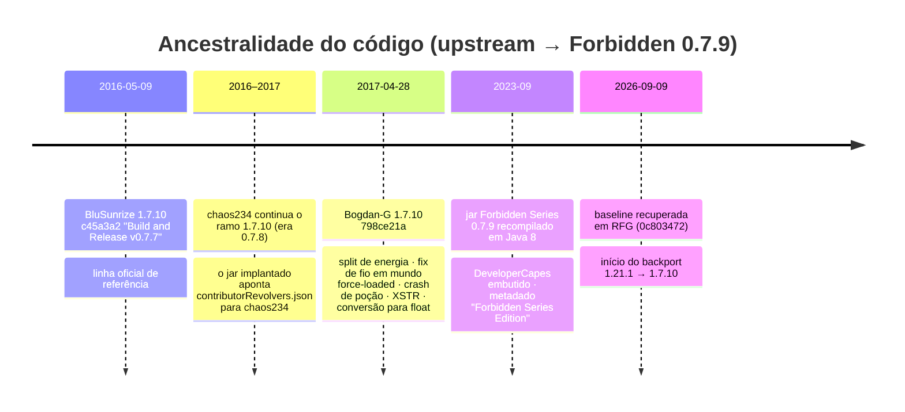

### 2b. 09–12/09/2026

As barras vão de um commit ao seguinte; **não** medem esforço.

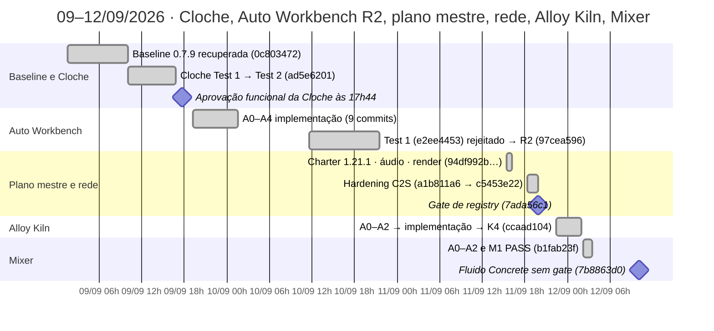

### 2c. 16–17/09/2026

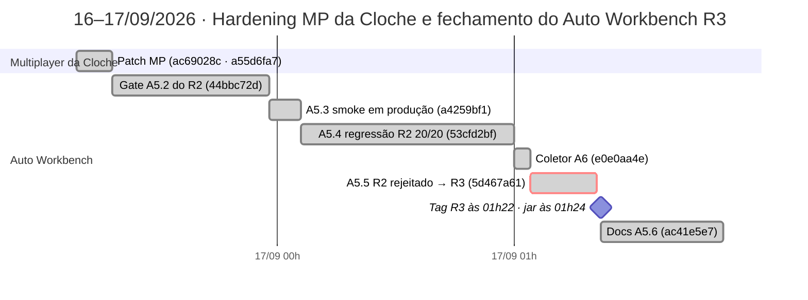

Entre 2b e 2c há um intervalo de 4 dias e 13 horas sem commits; depois de 2c, nada mais foi commitado até 25/10/2026.

## 3. Fluxo de gates do Auto Workbench (A0 → A8)

Mostra os dois ciclos de rejeição (OBJ misto no Test 1; estado/sincronização no R2) e onde o R3 está: **A6 pendente**.

```mermaid
flowchart TD
  classDef pass fill:#d4edda,stroke:#2e7d32,color:#111
  classDef fail fill:#f8d7da,stroke:#c62828,color:#111
  classDef pend fill:#fff3cd,stroke:#ef6c00,stroke-width:3px,color:#111
  classDef block fill:#eceff1,stroke:#90a4ae,color:#555,stroke-dasharray:4 3

  A0["A0 arqueologia de fonte e assets<br/>PASS"]:::pass --> A1["A1 registry · meta · TileEntity · GUI-ID<br/>PASS"]:::pass
  A1 --> A2["A2 arquitetura legacy · NBT · transação de processo<br/>PASS"]:::pass
  A2 --> A3["A3 implementação · compile · auditoria estática<br/>PASS"]:::pass
  A3 --> A4["A4 GUI · render · assets · lado dedicado<br/>PASS"]:::pass
  A4 --> A5["A5 artefato do tag auto-workbench-test-1<br/>PASS estático"]:::pass
  A5 --> A51{"A5.1 smoke de cliente isolado<br/>ModelFormatException no OBJ"}
  A51 -- "FALHOU: grupo com 289 quads + 4 triângulos" --> REJ1["auto-workbench-test-1<br/>REJEITADO · tag imutável"]:::fail
  REJ1 --> FIX1["quadify: triângulo A B C vira quad A B C C"]
  FIX1 --> A52["A5.2 R2 · build limpo · 1.405 entradas<br/>PASS"]:::pass
  A52 --> A53["A5.3 smoke no modpack real<br/>8,7 M de linhas · 0 erros de parser<br/>PASS"]:::pass
  A53 --> A54["A5.4 regressão reprodutível 20/20<br/>PASS"]:::pass
  A54 --> A55{"A5.5 revisão adversarial de estado"}
  A55 -- "markDirty ausente + RF da GUI sem canal de sync" --> REJ2["auto-workbench-test-1-r2<br/>REJEITADO em 17/09 · tag imutável"]:::fail
  REJ2 --> FIX2["R3: markDirty por tick ativo<br/>+ propriedade 0 em ICrafting"]
  FIX2 --> A56["A5.6 R3 · build limpo 2m55s<br/>artefato 21/21 · smoke 4 mods<br/>PASS"]:::pass
  A56 --> A6{{"A6 gameplay T0–T18 no Forbidden Series<br/>PENDENTE · sem evidência registrada<br/>VOCÊ ESTÁ AQUI"}}:::pend
  A6 -- "PASS + logs revisados" --> A8["A8 aprovação e congelamento"]:::block
  A6 -- "FAIL ou conflito logs × jogo" --> A7["A7 correção adversarial · Test 2"]:::block
  A7 --> A6
```

## 4. Máquina de estados de aprovação de uma feature

Definida em `IE-1.21.1-BACKPORT-MASTER-CHARTER.md` (branch `feature/mixer`).

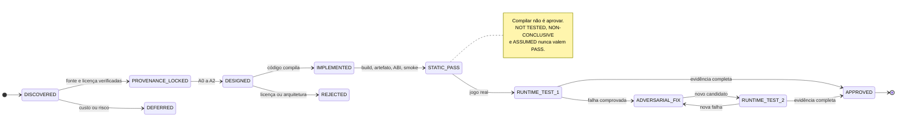

## 5. Estado de cada frente nessa máquina

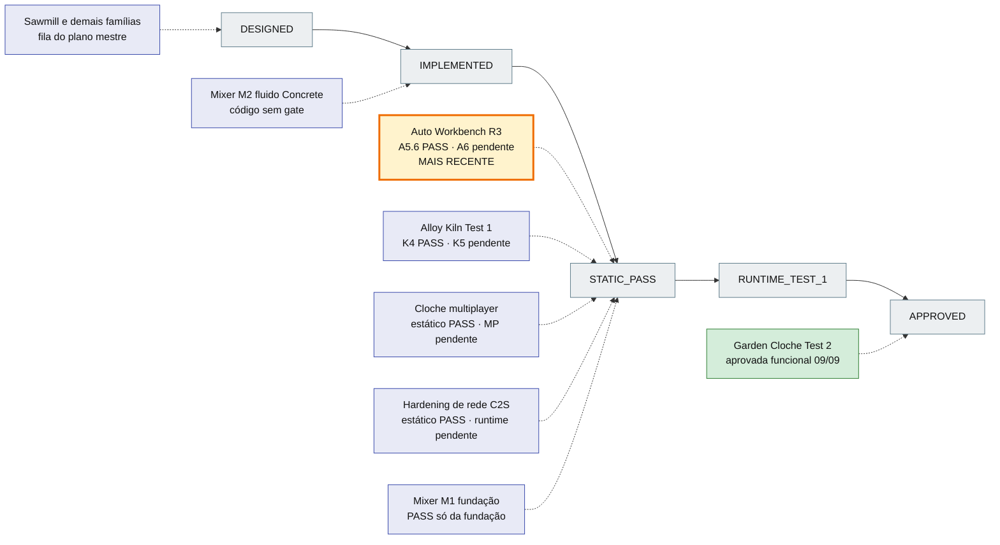

## 6. Cadeia de proveniência do código

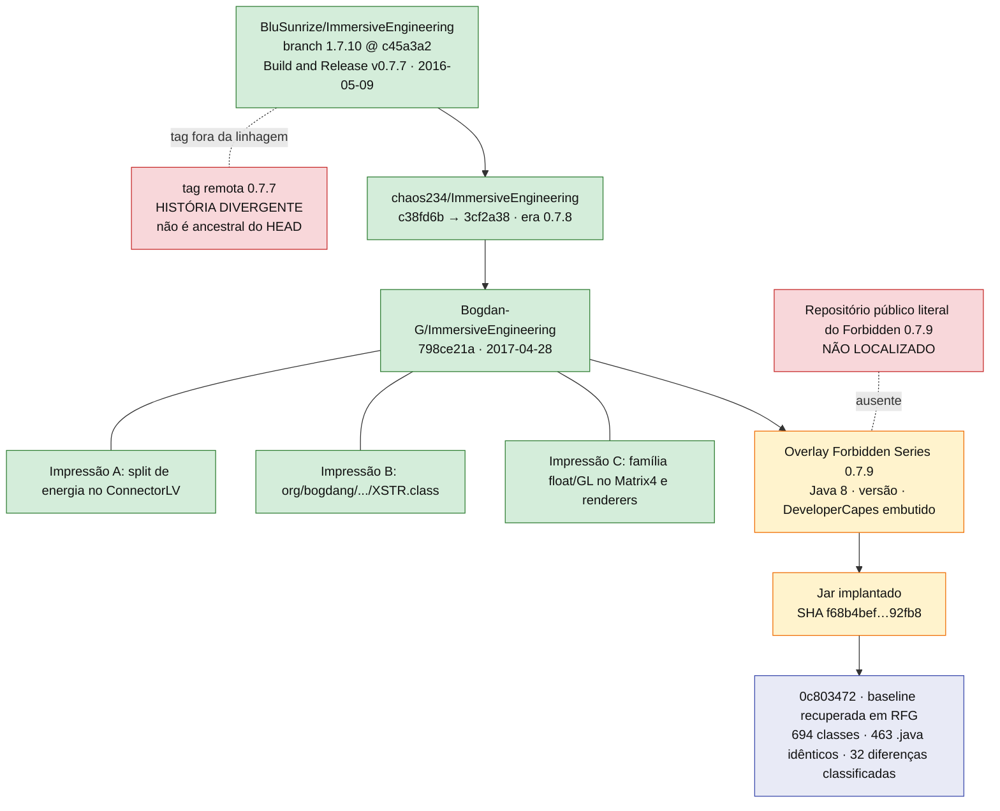

## 7. Arquitetura em camadas

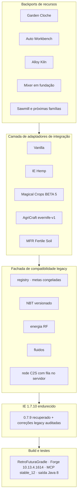

## 8. Árvore de decisão para retomar

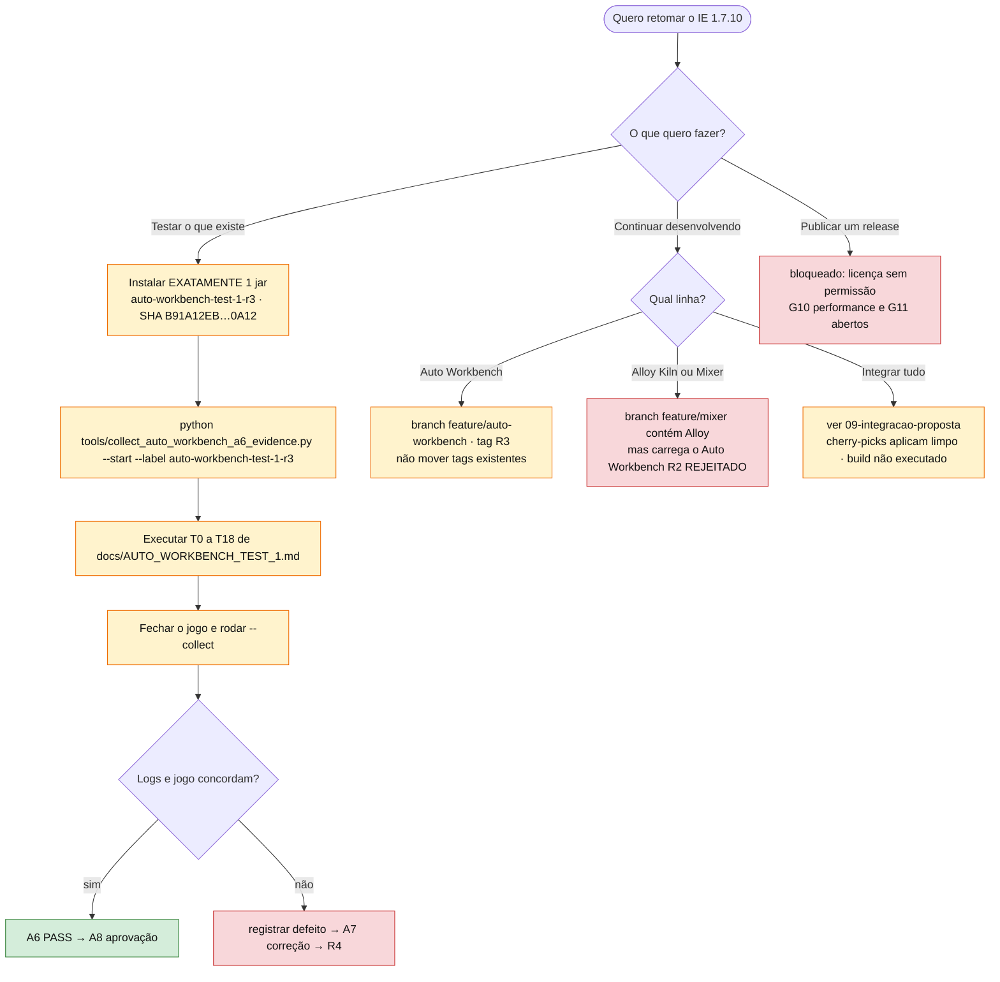

## 9. Integração proposta das linhas divergentes

**Proposta, não execução.** Um teste de aplicação em worktree descartável (`git cherry-pick -n`, sem build) mostrou que o código aplica; apenas `docs/engineering/ROADMAP.md` conflita. Detalhes e limites em [ESTADO-ATUAL-E-RETOMADA.md](ESTADO-ATUAL-E-RETOMADA.md#5-integração-das-linhas-divergentes).

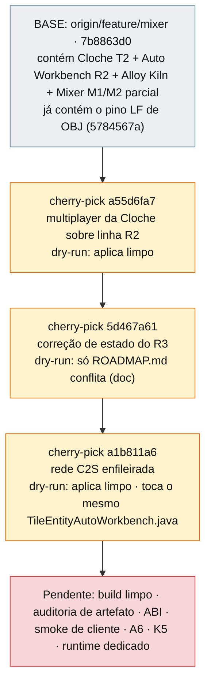

## 10. Candidatos e substituições

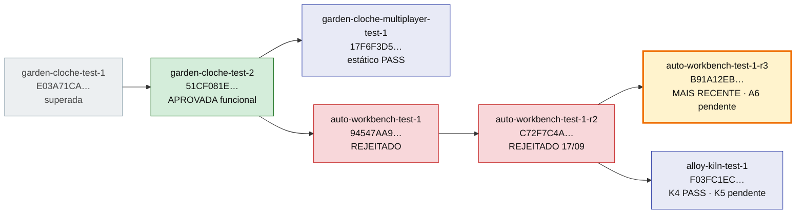
