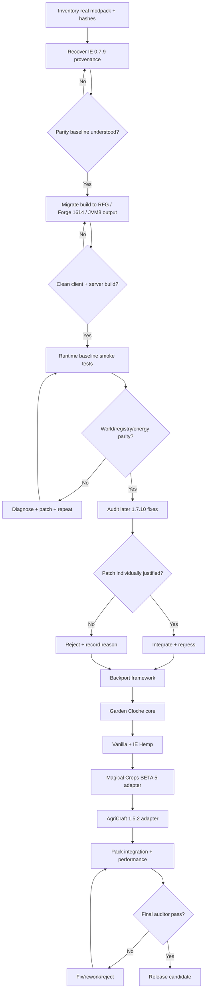

# Engineering Roadmap and Gates

## Flow

## Gate G0 — Evidence freeze
Status: PASS (initial), ongoing evidence additions allowed.

Acceptance:
- production mod directory inventoried;
- SHA-256 recorded for each mod;
- deployed IE binary archived only as evidence, not modified;
- official + community source references cloned separately.

## Gate G1 — Source provenance / baseline recovery
Status: IN PROGRESS, high confidence ancestry established.

Known chain:
- official BluSunrize 1.7.10 commit c45a3a2;
- chaos234 0.7.8-era continuation;
- Bogdan-G HEAD 798ce21 with distinctive energy and XSTR patches;
- deployed Forbidden 0.7.9 adds Java 8 packaging/version/cape behavior.

Exit criteria:
- every semantically meaningful 0.7.9 delta categorized as inherited, Forbidden overlay, compiler noise, bundled dependency, or unresolved;
- unresolved core-runtime deltas = 0.

## Gate G2 — Modern build parity
Status: IN PROGRESS.

Target:
- RetroFuturaGradle-based build;
- Minecraft 1.7.10;
- Forge 10.13.4.1614;
- MCP stable 12;
- production bytecode JVM 8;
- source may use modern build tooling, but gameplay semantics unchanged in this gate.

Exit criteria:
- `clean build` passes from a cold or documented cache;
- reobfuscated artifact produced;
- artifact contents inspected;
- dedicated server launch;
- client launch;
- no accidental shaded libraries unless explicitly approved.

## Gate G3 — Runtime parity
Status: BLOCKED by G2.

Tests:
- baseline config loads;
- existing world copy loads;
- all existing IE TileEntities deserialize;
- existing IE inventory contents survive;
- wire connections survive chunk unload/reload;
- RF/EU integration smoke tests;
- Arc Furnace / Metal Press / Crusher / Bottling / Excavator smoke tests;
- NEI opens recipes without crash;
- no new registry remap warnings.

## Gate G4 — Legacy hardening
Status: PLANNED.

Sources:
- quentin452 0.7.11-fork4;
- vladislemon continuation;
- other maintained 1.7.10 forks;
- relevant upstream later fixes where logically portable.

Rule: no bulk merge. Each patch receives:
1. issue/commit provenance;
2. applicability check to our lineage;
3. conflict analysis;
4. test;
5. approval or explicit rejection record.

## Gate G5 — Backport API framework
Status: PLANNED.

Deliverables:
- feature registration layer;
- Cloche crop/profile registry;
- adapter lifecycle;
- soft dependency loader;
- deterministic diagnostics;
- config feature flags;
- NEI hooks.

## Gate G6 — Garden Cloche core
Status: PLANNED.

Initial scope:
- machine block/TileEntity;
- energy consumption;
- fluid/fertilizer handling based on verified modern semantics adapted to 1.7.10 APIs;
- input/output transaction safety;
- client renderer isolated from server logic;
- Vanilla crops;
- IE Hemp;
- NEI/manual documentation.

Explicit non-goals for first Cloche build:
- every mod crop simultaneously;
- AgriCraft mutation/breeding inside the machine;
- world-block farming simulation.

## Gate G7 — Magical Crops BETA 5
Status: PLANNED.

Prerequisite audit:
- identify crop classes/metadata;
- maturity rules;
- seed and essence drop rules;
- fertilizer behavior;
- any special NBT;
- validate no dupes through simulated repeated harvests.

## Gate G8 — AgriCraft 1.5.2-evernife-v1
Status: PLANNED.

Prerequisite audit:
- identify exact API surface and NBT schema from installed JAR/source lineage;
- determine how seed stats are stored/read;
- determine output calculation and crop validation;
- decide whether Cloche accepts crop sticks or seed item directly based on verified implementation.

Constraint:
- machine must not silently improve genetics.

## Gate G9 — Wider ecosystem
Candidates, only after exact-version audit:
- Pam's HarvestCraft;
- Forestry;
- Natura/other installed plant mods;
- MineTweaker registration bridge if useful.

## Gate G10 — Performance and rendering
- profile ticking cost with 1, 16, 64, 256 Cloche instances;
- verify no per-tick allocations that scale poorly;
- profile wire network unchanged vs hardened baseline;
- Angelica smoke tests;
- dedicated-server classloading audit;
- heap/GC smoke test in real pack.

## Gate G11 — Release candidate
- clean build;
- signed-off compatibility matrix;
- known-issues list;
- upgrade instructions;
- config migration notes;
- SHA-256 artifact manifest;
- public distribution only after license/permission review.

## Review loop
Every failed gate returns to the smallest responsible layer. A failure in AgriCraft integration does not authorize a wire-network rewrite; a rendering failure does not authorize changing server crop simulation. Scope containment is mandatory.
