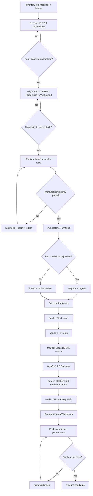

# Engineering Roadmap and Gates

## Flow

## Gate G0 — Evidence freeze
Status: PASS (initial), ongoing evidence additions allowed.

Acceptance:
- production mod directory inventoried;
- SHA-256 recorded for each mod;
- deployed IE binary archived only as evidence, not modified;
- official + community source references cloned separately.

## Gate G1 — Source provenance / baseline recovery
Status: PASS — baseline ancestry and semantic recovery accepted.

Known chain:
- official BluSunrize 1.7.10 commit c45a3a2;
- chaos234 0.7.8-era continuation;
- Bogdan-G HEAD 798ce21 with distinctive energy and XSTR patches;
- deployed Forbidden 0.7.9 adds Java 8 packaging/version/cape behavior.

Exit criteria:
- every semantically meaningful 0.7.9 delta categorized as inherited, Forbidden overlay, compiler noise, bundled dependency, or unresolved;
- unresolved core-runtime deltas = 0.

## Gate G2 — Modern build parity
Status: PASS — clean RFG/reobf build and baseline gate accepted.

Target:
- RetroFuturaGradle-based build;
- Minecraft 1.7.10;
- Forge 10.13.4.1614;
- MCP stable 12;
- production bytecode JVM 8;
- source may use modern build tooling, but gameplay semantics unchanged in this gate.

Exit criteria:
- `clean build` passes from a cold or documented cache;
- reobfuscated artifact produced;
- artifact contents inspected;
- dedicated server launch;
- client launch;
- no accidental shaded libraries unless explicitly approved.

## Gate G3 — Runtime parity
Status: ACTIVE / PARTIAL — feature-development runtime proven; full release-parity matrix remains open.

Tests:
- baseline config loads;
- existing world copy loads;
- all existing IE TileEntities deserialize;
- existing IE inventory contents survive;
- wire connections survive chunk unload/reload;
- RF/EU integration smoke tests;
- Arc Furnace / Metal Press / Crusher / Bottling / Excavator smoke tests;
- NEI opens recipes without crash;
- no new registry remap warnings.

## Gate G4 — Legacy hardening
Status: PLANNED.

Sources:
- quentin452 0.7.11-fork4;
- vladislemon continuation;
- other maintained 1.7.10 forks;
- relevant upstream later fixes where logically portable.

Rule: no bulk merge. Each patch receives:
1. issue/commit provenance;
2. applicability check to our lineage;
3. conflict analysis;
4. test;
5. approval or explicit rejection record.

## Gate G5 — Backport API framework
Status: PARTIAL PASS — minimum framework proven by Garden Cloche; generic expansion remains ongoing.

Deliverables:
- feature registration layer;
- Cloche crop/profile registry;
- adapter lifecycle;
- soft dependency loader;
- deterministic diagnostics;
- config feature flags;
- NEI hooks.

## Gate G6 — Garden Cloche core
Status: PASS — `garden-cloche-test-2`, runtime approved 2026-09-09.

Initial scope:
- machine block/TileEntity;
- energy consumption;
- fluid/fertilizer handling based on verified modern semantics adapted to 1.7.10 APIs;
- input/output transaction safety;
- client renderer isolated from server logic;
- Vanilla crops;
- IE Hemp;
- NEI/manual documentation.

Explicit non-goals for first Cloche build:
- every mod crop simultaneously;
- AgriCraft mutation/breeding inside the machine;
- world-block farming simulation.

## Gate G7 — Magical Crops BETA 5
Status: PASS — exact installed BETA5 adapter validated in approved Test 2.

Prerequisite audit:
- identify crop classes/metadata;
- maturity rules;
- seed and essence drop rules;
- fertilizer behavior;
- any special NBT;
- validate no dupes through simulated repeated harvests.

## Gate G8 — AgriCraft 1.5.2-evernife-v1
Status: PASS — exact evernife-v1 genetic adapter validated in approved Test 2.

Prerequisite audit:
- identify exact API surface and NBT schema from installed JAR/source lineage;
- determine how seed stats are stored/read;
- determine output calculation and crop validation;
- decide whether Cloche accepts crop sticks or seed item directly based on verified implementation.

Constraint:
- machine must not silently improve genetics.

## Gate G8.5 — Modern Feature Gap Audit
Status: PASS — 2026-09-09.

Decision:
- genuine later-feature gaps classified semantically, not by filename alone;
- 1.12 `0.12-89` used as reproducible mature snapshot with later 1.12 fixes audited per feature;
- Automated Engineer's Workbench ranked first at 92/100;
- Alloy Kiln and Mixer ranked next at 83/100;
- high-blast-radius wire/conveyor families deferred.

Evidence: `MODERN-FEATURE-GAP-AUDIT.md`.

## Gate G8.6 — Feature #2: Automated Engineer's Workbench
Status: A5.5 R3 source hardening PASS; A6 BLOCKED pending R3 tagged build/artifact/runtime-smoke gates.

Execution gates A0–A8 are defined in `AUTO-WORKBENCH-FEATURE-CHARTER.md`.
- A0 source/asset archaeology: PASS.
- A1 registry/meta/TileEntity/GUI-ID design: PASS.
- A2 legacy architecture, NBT and process transaction design: PASS.
- A3 core implementation/compile/static audit: PASS.
- A4 GUI/render/assets/dedicated-side audit: PASS.
- A5 original tagged artifact audit: PASS, but original candidate later rejected by runtime smoke.
- A5.1 runtime-smoke rework: PASS; mixed triangle/quad OBJ defect fixed and lifecycle smoke validated.
- A5.2 replacement R2 clean tagged build/artifact audit: PASS.
- A5.3 production-pack startup/classloading smoke: PASS; R2 loads through the real transformer stack with zero Auto Workbench parser exception.
- A5.4 R2 reproducible regression gate: PASS; 20/20 identity/artifact/topology/transform/structure checks, later superseded by deeper state audit.
- A5.5 state persistence/GUI sync audit: R2 REJECTED; R3 source hardening PASS pre-tag.
- A6 user runtime Test 1: BLOCKED until R3 repeats clean build, artifact audit and startup smoke; evidence-capture tooling remains ready.
- A7 adversarial fix/Test 2: BLOCKED by A6 evidence.
- A8 runtime approval/freeze: BLOCKED by A6/A7.

Evidence: `AUTO-WORKBENCH-A0-A2-DESIGN.md`, `AUTO-WORKBENCH-A4-RENDER-GATE.md`, `AUTO-WORKBENCH-A5-ARTIFACT-GATE.md`, `AUTO-WORKBENCH-A5.1-RUNTIME-SMOKE-GATE.md`, `AUTO-WORKBENCH-A5.2-R2-FINAL-GATE.md`, `AUTO-WORKBENCH-A5.3-PRODUCTION-STARTUP-SMOKE.md`, `AUTO-WORKBENCH-A5.4-REGRESSION-GATE.md`, `AUTO-WORKBENCH-A5.5-STATE-SYNC-GATE.md`, `AUTO-WORKBENCH-A6-EVIDENCE-PROTOCOL.md`, and `../AUTO_WORKBENCH_TEST_1.md`.
## Gate G9 — Wider ecosystem
Status: DEFERRED / NON-BLOCKING while Feature #2 proceeds.

Candidates, only after exact-version audit:
- Pam's HarvestCraft;
- Forestry;
- Natura/other installed plant mods;
- MineTweaker registration bridge if useful.

## Gate G10 — Performance and rendering
- profile ticking cost with 1, 16, 64, 256 Cloche instances;
- verify no per-tick allocations that scale poorly;
- profile wire network unchanged vs hardened baseline;
- Angelica smoke tests;
- dedicated-server classloading audit;
- heap/GC smoke test in real pack.

## Gate G11 — Release candidate
- clean build;
- signed-off compatibility matrix;
- known-issues list;
- upgrade instructions;
- config migration notes;
- SHA-256 artifact manifest;
- public distribution only after license/permission review.

## Review loop
Every failed gate returns to the smallest responsible layer. A failure in AgriCraft integration does not authorize a wire-network rewrite; a rendering failure does not authorize changing server crop simulation. Scope containment is mandatory.
